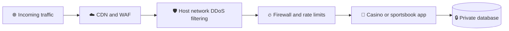

<div align="center">

<h1>🎰 How Much Does an iGaming Dedicated Server Cost In 2026?</h1>

<h3>Complete Pricing Guide for Casinos, Sportsbooks and Poker Rooms</h3>
 
<p>
  
  
  
  
  
</p>
</div>
---
 
> 🏟️ **It is the 85th minute of a Champions League match.** Thousands of players are placing live bets, odds are changing every few seconds, and your server suddenly starts to crawl.
 
Every slow page is a missed bet. Every missed bet is a player who may never come back. ⏱️ In that moment, hosting stops being a line item and becomes the foundation of your business.
 
That is why operators ask the same question before launch: **how much does an iGaming Dedicated Server cost in 2026?** The answer depends on your traffic, your games, and the protection you need.
 
📌 This guide covers real prices, hidden costs, DDoS defense, and a simple way to choose a plan without overspending.
 
> [!TIP]
> **⚡ TL;DR**
>
> - 💵 Plans run from **$105.99/mo** to **$1,664.99/mo** on QloudHost
> - 🎯 Many single-brand platforms land between roughly **$400 and $900/mo**
> - 🛡️ Basic hardware-level DDoS protection is included on every plan
> - 🆓 Zero setup fees and free migration
> - 🪙 Pay with USDT and other crypto, plus cards, PayPal and bank transfer
 
---
 
## 📑 Table of Contents
 
1. [🎰 Why Casino and Sportsbook Platforms Run on Dedicated Servers](#-why-casino-and-sportsbook-platforms-run-on-dedicated-servers)
2. [💰 The Short Answer on Pricing](#-igaming-dedicated-server-pricing-in-2026-the-short-answer)
3. [📊 Price List by Platform Size](#-igaming-dedicated-server-price-list-by-platform-size)
4. [🧮 What Decides the Price](#-what-decides-the-price-of-an-igaming-dedicated-server)
5. [🚨 Hidden Costs to Watch Out For](#-hidden-costs-to-watch-out-for)
6. [🆚 Dedicated vs VPS vs Public Cloud](#-dedicated-server-vs-vps-vs-public-cloud-the-cost-comparison)
7. [🔒 DDoS Protection for Casinos and Sportsbooks](#-how-to-protect-your-casino-or-sportsbook-from-ddos-attacks)
8. [🎯 How to Choose the Right Plan](#-how-to-choose-the-right-plan-without-overspending)
9. [🚀 QloudHost iGaming Dedicated Server](#-qloudhost-igaming-dedicated-server-transparent-pricing-built-for-gaming)
10. [✅ Is It Worth the Price?](#-is-an-igaming-dedicated-server-worth-the-price)
11. [❓ FAQs](#-faqs)
12. [🏁 Conclusion](#-conclusion)
---
 
## 🎰 Why Casino and Sportsbook Platforms Run on Dedicated Servers
 
Online casinos and sportsbooks handle real money, live data, and thousands of players at the same time. That is a very different job from running a blog or a brochure website.
 
| 🎯 Platform | ⚙️ What it has to handle | 🖥️ What it needs from the server |
|---|---|---|
| 🎰 Online casino | Game engines, wallets, payment callbacks, a busy database | Strong CPU, plenty of RAM, fast NVMe storage |
| ⚽ Sportsbook | Live odds feeds and in-play betting | Low latency and steady single-thread speed |
| ♠️ Poker room | Many tables running at once | Stable, low-latency connections |
| 📺 Live dealer | Video streams to many players | Big bandwidth and a fast port |
 
On shared hosting, a noisy neighbor can eat the CPU you need on your busiest night. A dedicated server removes that risk because the whole machine is yours. The speed you test on Monday is the speed players get on Saturday.
 
🧾 Dedicated hardware also keeps your data on your own physical disks, which helps when an auditor or regulator asks where your records are stored.
 
---
 
## 💰 iGaming Dedicated Server Pricing in 2026: The Short Answer
 
Prices start near one hundred dollars a month and can pass sixteen hundred for a multi-brand platform. Where you land depends mostly on the size of your operation.
 
On QloudHost, an **iGaming Dedicated Server** starts at **$105.99 per month** for an Intel Xeon E3-1230v6 and goes up to **$1,664.99 per month** for a 96-core AMD EPYC 9655P. In practice, many single-brand casinos and sportsbooks sit between roughly **$400 and $900 per month**.
 
| 📅 Plan | 💵 Monthly | 🗓️ Yearly (approx.) |
|---|---|---|
| 🟢 Entry: Xeon E3-1230v6 | $105.99 | about $1,272 |
| ⭐ Most popular: EPYC 7402P | $624.99 | about $7,500 |
| 🔴 Enterprise: EPYC 9655P | $1,664.99 | about $19,980 |
 
> [!NOTE]
> The prices in this guide include a 20% saving over the regular rate at the time of writing, and there are no setup fees. Prices can change, so confirm the current figure on the website before you order.
 
---
 
## 📊 iGaming Dedicated Server Price List by Platform Size
 
The table lists 12 configurations, from entry level to enterprise. Every price is monthly, and every server comes with a dedicated IPv4 address and full root access.
 
| 🏷️ Tier | 🖥️ Server | 🧠 Cores | 💾 RAM | 💿 Storage | 🌐 Port | 💵 Price/mo |
|---|---|---|---|---|---|---|
| 🟢 Entry | Intel Xeon E3-1230v6 | 4 | 32 GB DDR4 ECC | 250 GB SSD + 1.92 TB HDD | 1 Gbps | **$105.99** |
| 🟢 Entry | AMD Ryzen 7 9700X | 8 | 64 GB DDR5 | 2x 1.92 TB NVMe | 1 Gbps | **$244.99** |
| 🟢 Entry | AMD Ryzen 9 9900X | 12 | 64 GB DDR5 | 2x 1.92 TB NVMe | 1 Gbps | **$266.99** |
| 🟢 Entry | Intel Xeon E5-2680 v3 | 12 | 64 GB DDR4 | 960 GB NVMe | 1 Gbps | **$291.99** |
| 🔵 Growth | Intel Xeon E5-2683 v4 | 16 | 64 GB DDR4 | 960 GB NVMe | 1 Gbps | **$399.99** |
| 🔵 Growth | AMD EPYC 4565P | 16 | 64 GB DDR5 ECC | 2x 1.92 TB NVMe | 1 Gbps | **$479.99** |
| 🔵 Growth | 2x Intel Xeon Gold 6230R | 52 | 128 GB DDR4 | 2x 960 GB NVMe | 1 Gbps | **$599.99** |
| 🔵 Growth ⭐ | AMD EPYC 7402P | 24 | 128 GB DDR4 ECC | 2x 480 GB SSD + 10x 14 TB HDD | 1 Gbps | **$624.99** |
| 🟠 High traffic | AMD EPYC 9355P | 32 | 128 GB DDR5 ECC | 2x 960 GB NVMe | 🚀 10 Gbps | **$799.99** |
| 🟠 High traffic | AMD EPYC 7763 | 64 | 256 GB DDR4 ECC | 1.92 TB NVMe | 1 Gbps | **$899.99** |
| 🟠 High traffic | Intel Xeon 6741P | 48 | 128 GB DDR5 ECC | 2x 960 GB NVMe | 🚀 10 Gbps | **$909.99** |
| 🔴 Enterprise | AMD EPYC 9655P | 96 | 256 GB DDR5 ECC | 2x 1.92 TB NVMe | 🚀 10 Gbps | **$1,664.99** |
 
📦 Monthly transfer is included in the price, from 50 TB to 100 TB depending on the plan.
 
### 📈 How the prices climb
 
```text
Xeon E3-1230v6       █░░░░░░░░░░░░░░░░░░░  $105.99
Ryzen 7 9700X        ███░░░░░░░░░░░░░░░░░  $244.99
Ryzen 9 9900X        ███░░░░░░░░░░░░░░░░░  $266.99
Xeon E5-2680 v3      ████░░░░░░░░░░░░░░░░  $291.99
Xeon E5-2683 v4      █████░░░░░░░░░░░░░░░  $399.99
EPYC 4565P           ██████░░░░░░░░░░░░░░  $479.99
2x Xeon Gold 6230R   ███████░░░░░░░░░░░░░  $599.99
EPYC 7402P           ████████░░░░░░░░░░░░  $624.99
EPYC 9355P           ██████████░░░░░░░░░░  $799.99
EPYC 7763            ███████████░░░░░░░░░  $899.99
Xeon 6741P           ███████████░░░░░░░░░  $909.99
EPYC 9655P           ████████████████████  $1,664.99
```
 
### 🧭 Which tier fits which business?
 
| 🏷️ Tier | 💵 Price range | 👥 Best for |
|---|---|---|
| 🟢 **Entry** | $105.99 to $291.99 | Affiliate networks, staging servers, and new casinos with limited traffic |
| 🔵 **Growth** | $399.99 to $624.99 | Single-brand casinos and sportsbooks with steady traffic. The EPYC 7402P is marked as the most popular plan |
| 🟠 **High traffic** | $799.99 to $909.99 | Big match-day peaks, live dealer streams, or many players online at once. The EPYC 9355P and Xeon 6741P include 10 Gbps ports |
| 🔴 **Enterprise** | $1,664.99 | Multi-brand platforms that run several sites from one machine |
 
---
 
## 🧮 What Decides the Price of an iGaming Dedicated Server?
 
Two servers can look similar on paper and still differ by hundreds of dollars. These are the factors that move the price the most.
 
| 🔧 Factor | 💡 Why it matters |
|---|---|
| 🧠 **CPU** | More cores help when many players are online together. Higher clock speed helps game and odds engines that depend on single-thread speed |
| 💾 **RAM** | Databases, caching, and live odds all love memory. ECC memory corrects errors before they can damage a balance or a bet record |
| 💿 **Storage** | NVMe keeps database queries fast but costs more than HDDs. Large HDDs are a cheaper home for logs, backups, and archives |
| 🌐 **Bandwidth and port** | Live dealer streams and match-day traffic need a bigger pipe. Higher port speeds usually come on higher-end plans |
| 🛡️ **DDoS protection** | Some hosts include it, others charge extra. Always check before you compare prices |
| 📍 **Location** | Location affects latency for your players and sometimes the price. A well-connected hub keeps bets and odds moving fast |
| 🧑‍💻 **Support and migration** | 24/7 engineers and free migration add real value, even when they never show up as a line on the invoice |
 
<details>
<summary><b>🧮 Click to see the cost per CPU core</b></summary>
<br>
| 🖥️ Server | 🧠 Cores | 💵 Price/mo | 🪙 Cost per core |
|---|---|---|---|
| 2x Intel Xeon Gold 6230R | 52 | $599.99 | about $11.54 |
| AMD EPYC 7763 | 64 | $899.99 | about $14.06 |
| AMD EPYC 9655P | 96 | $1,664.99 | about $17.34 |
| Intel Xeon 6741P | 48 | $909.99 | about $18.96 |
| AMD Ryzen 9 9900X | 12 | $266.99 | about $22.25 |
| AMD EPYC 9355P | 32 | $799.99 | about $25.00 |
| AMD EPYC 7402P | 24 | $624.99 | about $26.04 |
| Intel Xeon E3-1230v6 | 4 | $105.99 | about $26.50 |
 
> [!NOTE]
> Cost per core is only one number. The EPYC 9655P costs more per core than the dual Xeon Gold, but it brings DDR5 memory, a faster clock, and a 10 Gbps port.
 
</details>
---
 
## 🚨 Hidden Costs to Watch Out For
 
The monthly price on a plan page is not always the price you end up paying. Before you sign, tick through this checklist.
 
- [ ] 💸 **Setup and activation fees:** Some hosts charge a one-time fee. QloudHost charges none
- [ ] 📶 **Bandwidth overage:** Going past your transfer limit can mean steep charges
- [ ] 🛡️ **DDoS add-ons:** Protection that is paid for only after the first attack costs the most when you need it the most
- [ ] 🌐 **Extra IP addresses:** Large platforms often need more than one IPv4 address
- [ ] 🚚 **Migration fees:** Moving your platform and database can be billed by the hour
- [ ] 🔑 **Software licenses:** Control panels and Windows Server licenses may cost extra with some hosts
> [!WARNING]
> Hosting is only one part of your total budget. A gaming license for every market you serve, game provider fees, payment processing, KYC and AML checks, RNG certification, a CDN, and monitoring all sit outside the server price. A host cannot give you a gambling license, so plan and budget for it separately.
 
---
 
## 🆚 Dedicated Server vs VPS vs Public Cloud: The Cost Comparison
 
The cheapest option on paper is not always the cheapest option in practice. Here is how the three choices compare for real-money platforms.
 
| 🎯 What matters | 🖥️ Dedicated Server | 💻 VPS | ☁️ Public Cloud |
|---|---|---|---|
| ⚙️ CPU and RAM | 100% yours, no neighbors | Shared host, can slow at peak | Shared host, varies by instance |
| ⚡ Speed during big events | Same speed at any hour | Drops when other users get busy | Scales, but costs jump |
| 💵 Monthly cost | Fixed price, 50 to 100 TB included on QloudHost | Low and fixed | Pay per use, bandwidth often billed extra |
| 🔐 Data isolation | Your own physical disks | Virtual disk on shared storage | Virtual disk on shared storage |
| 🎲 Gambling friendly | Yes at QloudHost, USDT accepted | Depends on the provider | Some providers restrict gambling workloads |
| 🏆 Best for | Casinos, sportsbooks, poker, platforms | Affiliate sites, staging, small projects | Short traffic spikes, global apps |
 
> [!TIP]
> Just starting with an affiliate or landing site? A casino VPS is a lower-cost first step, and you can move to a dedicated server when real-money traffic grows.
 
---
 
## 🔒 How to Protect Your Casino or Sportsbook From DDoS Attacks
 
Casinos and sportsbooks are favorite targets for attackers because downtime costs real money. Attacks often arrive during big matches, promotions, and tournaments, when the pressure is highest.
 
### 🧨 Know the three attack types
 
| 💥 Attack type | 🔍 What it does | 📌 Typical example |
|---|---|---|
| 🌊 **Volumetric** | Floods your network with traffic | UDP floods, DNS amplification |
| 🔁 **Protocol** | Exhausts server resources | SYN floods |
| 🖱️ **Application layer** | Hits login and betting pages with requests that look almost normal | HTTP floods |
 
### 🧅 Build protection in layers
 

 
<details>
<summary><b>1️⃣ Network filtering from your host</b></summary>
<br>
Look for hardware-level DDoS protection that filters common network attacks before they reach your server.
 
</details>
<details>
<summary><b>2️⃣ A CDN or WAF in front of your site</b></summary>
<br>
Serve static files from the edge and filter bad requests before they touch your server.
 
</details>
<details>
<summary><b>3️⃣ A hidden origin IP</b></summary>
<br>
Allow web traffic only from your CDN, and remove old DNS records that reveal the real server address.
 
</details>
<details>
<summary><b>4️⃣ Firewall and rate limiting</b></summary>
<br>
Limit login attempts, bet submissions, and API calls per IP, and block every port you do not need.
 
</details>
<details>
<summary><b>5️⃣ A private database</b></summary>
<br>
Never expose the database port to the internet. Use SSH keys and two-factor login for admin access.
 
</details>
<details>
<summary><b>6️⃣ Spare capacity</b></summary>
<br>
More CPU, more RAM, and a 10 Gbps port give you room to absorb a spike while mitigation does its work.
 
</details>
<details>
<summary><b>7️⃣ Monitoring and a plan</b></summary>
<br>
Set alerts for traffic and response time, and keep your host's support contact ready before an attack, not after.
 
</details>
> [!IMPORTANT]
> Basic protection is a strong first layer, but it is not a full shield. Large or application layer attacks need a CDN, a WAF, and good server habits on top. Factor these into your budget when you compare prices.
 
### ✅ Quick DDoS readiness checklist
 
- [ ] Hardware-level DDoS protection is included in the price
- [ ] A CDN or WAF sits in front of the site
- [ ] The origin IP is hidden and old DNS records are removed
- [ ] Rate limits are set on login, bets, and APIs
- [ ] The database port is closed to the internet
- [ ] Alerts and an incident plan are ready
---
 
## 🎯 How to Choose the Right Plan Without Overspending
 
The best server is the one that fits your workload today and leaves room to grow. These six steps help you get there without paying for power you will not use.
 
| 🔢 Step | 🧭 What to do |
|---|---|
| 1️⃣ **Estimate your peak, not your average** | Count the players online during your busiest match or promotion |
| 2️⃣ **Match the hardware to the workload** | Database heavy platforms need NVMe and RAM, while live dealer streams need bandwidth and a fast port |
| 3️⃣ **Leave room to grow** | A server that is already full on launch day will cost you more to fix later |
| 4️⃣ **Check what is included** | Compare DDoS protection, setup fees, migration, and support, not only the headline price |
| 5️⃣ **Compare the total cost** | Add bandwidth, IPs, licenses, and add-ons to every quote |
| 6️⃣ **Ask for a custom quote** | If no plan fits, a good host will build a server around your workload |
 
---
 
## 🚀 QloudHost iGaming Dedicated Server: Transparent Pricing Built for Gaming
 
Pricing is only useful when it is clear and complete. QloudHost lists every iGaming Dedicated Server price openly, so you know the cost before you talk to sales.
 
Servers are hosted in Amsterdam, one of Europe's best connected hosting locations and home to AMS-IX, one of the largest internet exchanges in the world. Most European players reach your platform in a few milliseconds.
 
| ✨ Feature | 📋 What you get on every plan |
|---|---|
| 💸 **Setup fees** | Zero |
| 🚚 **Migration** | Free, for your platform and database |
| 🛡️ **DDoS protection** | Basic hardware-level protection at no extra cost |
| 🖥️ **Hardware** | Single-tenant, dedicated IPv4, full root access, and KVM (IPMI on request) |
| ⚡ **Power** | Up to 96 cores, ports up to 10 Gbps, and 50 to 100 TB of monthly transfer |
| 💳 **Payments** | USDT and other crypto, plus cards, PayPal, and bank transfer |
| 🧑‍💻 **Support** | 24/7 engineers with a 99.95% uptime target |
| 🐧 **OS and panels** | AlmaLinux, CentOS, Debian, Ubuntu, or Windows Server, with panels such as DirectAdmin and cPanel |
| 📍 **Location** | Amsterdam, Netherlands |
 
🔧 **Need something bigger?** Custom builds go up to 500 GB of RAM, a 16 TB primary drive, a 56 TB secondary drive, and up to 10 Gbps unmetered bandwidth, with up to 10 TB of backup space.
 
💬 **Our recommendation is simple.** If you run a casino, sportsbook, or poker room and want clear pricing, crypto payments, and a team that helps you move, QloudHost is a strong place to start.
 
> [!NOTE]
> QloudHost provides the infrastructure. Your gaming license, KYC and AML checks, and game certification remain your responsibility.
 
<div align="center">
### 👉 [**Explore QloudHost iGaming Dedicated Servers**](https://qloudhost.com/igaming-dedicated-servers) 👈
 
</div>
---
 
## ✅ Is an iGaming Dedicated Server Worth the Price?
 
A server is one of the few costs that decides whether your platform is open or closed when players arrive. The fair way to judge the price is to compare it with the cost of downtime.
 
For a busy platform, one hour offline during a major match can cost more than a full month of hosting. Lost bets are only part of the damage, because players who hit errors often move to a competitor and may not come back.
 
A dedicated server gives you predictable monthly costs, steady performance, full control, and cleaner records for audits. For real-money platforms, that combination is usually worth the price. 💪
 
---
 
## ❓ FAQs
 
Here are quick answers to the questions operators ask most about iGaming Dedicated Server pricing. Click any question to open the answer.
 
<details>
<summary><b>💵 How much does an iGaming Dedicated Server cost in 2026?</b></summary>
<br>
On QloudHost, plans run from $105.99 per month for a 4-core Xeon to $1,664.99 per month for a 96-core AMD EPYC. Many single-brand casinos and sportsbooks fall between roughly $400 and $900 per month, depending on traffic and storage needs.
 
</details>
<details>
<summary><b>⚖️ Is a dedicated server more expensive than a VPS?</b></summary>
<br>
Yes, the monthly price is higher. But a dedicated server gives you the whole machine, fixed costs, and steady speed at peak hours, which real-money platforms need. For small projects, a casino VPS is a cheaper starting point.
 
</details>
<details>
<summary><b>🆓 Are there setup fees or hidden charges?</b></summary>
<br>
QloudHost charges zero setup fees on every plan, and migration help is free. Even so, always check bandwidth overage, extra IPs, and DDoS add-ons when you compare other hosts.
 
</details>
<details>
<summary><b>🛡️ Is DDoS protection included in the price?</b></summary>
<br>
Yes. Every QloudHost iGaming server includes basic hardware-level DDoS protection that filters common network attacks. For larger or application layer attacks, add a CDN, a WAF, and rate limiting on top.
 
</details>
<details>
<summary><b>🪙 Can I pay for an iGaming Dedicated Server with USDT?</b></summary>
<br>
Yes. QloudHost accepts USDT and other cryptocurrencies, along with cards, PayPal, and bank transfer. This suits crypto casinos that want their billing to match their business.
 
</details>
<details>
<summary><b>📜 Does my host provide a gambling license?</b></summary>
<br>
No. A hosting provider cannot issue a gaming license. You must hold a valid license for every market you serve and follow your host's Fair Usage Policy.
 
</details>
<details>
<summary><b>🔧 How much RAM, storage, and bandwidth can I add?</b></summary>
<br>
Custom builds go up to 500 GB of RAM, a 16 TB primary drive, a 56 TB secondary drive, up to 10 Gbps unmetered bandwidth, and 10 TB of backup space. Ask for a custom quote if no standard plan fits.
 
</details>
---
 
## 🏁 Conclusion
 
Pricing an iGaming Dedicated Server is not about finding the cheapest number on a page. It is about matching the right hardware to your traffic, protecting your platform from attacks, and avoiding surprise charges that appear after launch.
 
From **$105.99** for a starter Xeon to **$1,664.99** for a 96-core EPYC, there is a plan for every stage of a casino or sportsbook. Add DDoS protection, fast NVMe storage, enough bandwidth, and a license you handle properly, and your platform is ready for its busiest night. 🎯
 
> 💎 **Bottom line:** Judge a server by its total cost, its protection, and its uptime, not by the headline price alone.
 
<div align="center">

### 🎰 Ready to launch your platform?
 
<a href="https://qloudhost.com/igaming-dedicated-servers"></a>
 
⭐ **Found this guide useful?** Star this repo and share it with a fellow operator.
 
<sub>`#iGamingDedicatedServer` `#CasinoHosting` `#SportsbookHosting` `#DDoSProtection` `#DedicatedServer` `#CryptoCasino` `#Amsterdam`</sub>
 
<sub>Prices and specs reflect the QloudHost iGaming Dedicated Servers page at the time of writing. Please confirm current details on the website.</sub>
 
</div>
 
Claude finished the response
